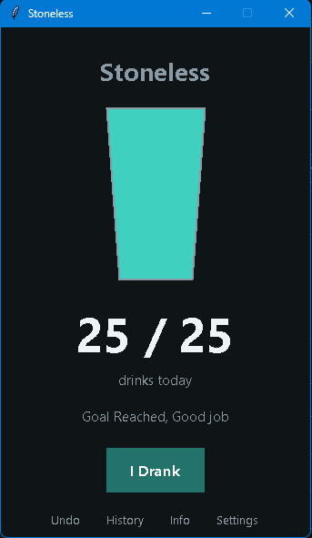
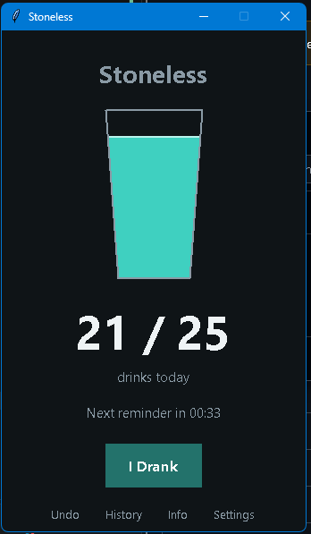
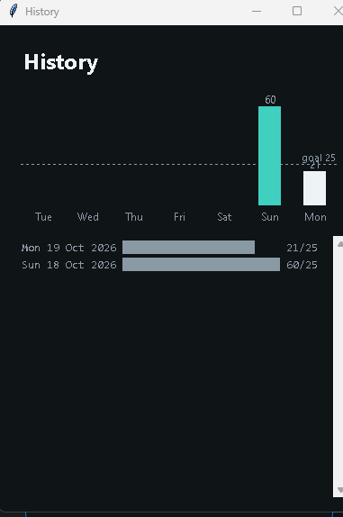
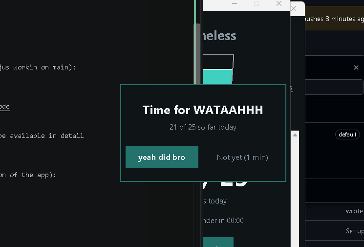
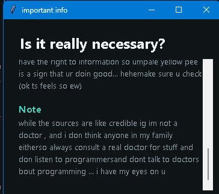
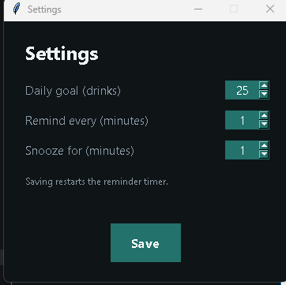
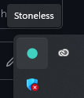
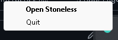

# Stoneless

it is a water tracking app , which keeps track of how much water ur drinking throughout the day,
it also reminds you to drink water based on user config.

we named it stoneless cuz bad water habits can cause kidney stones ig.
we jus named it cuz its funn

### Progress

this is a project for thirdspace.hackclub.com with a week worth of contributions and code
-  we will be shipping a final update in week 6
-  till then most of the app will remain dysfunctional due to cross platform and different versions of the app we contributed to.

## Tech we used :
-  python 
-  tkinter
-  psutil
-  pip
-  pystray
-  git,github
-  sum other python related things
-  Ai for debugging and help, lots of debugging

## Features:
(not fully funtional features described as planned as of now) 
### the base featueres are :
-  Water drinking reminder
-  Water drinking recorder/tracker
-  Water history
-  water info and about the basis of the app and reasearch info
-  settings for managing timer duration and stuff
-  themes , a few themes 
-  system tray icon 
-  cross platform compatibilty i.e linux/windows
-  undo button incase u might un-drink ur glass of water........ ..

## contributers/team:

Aleeza zahra:
https://github.com/Kn1ghtmere/Stoneless/tree/aleeza

Subhan(he din make his own branch idk ynot , so hes jus workin on main):
https://github.com/Kn1ghtmere/Stoneless

Kn1ghtmere (me):
https://github.com/Kn1ghtmere/Stoneless/tree/kn1ghtcode

in the final ship , the contribution info will also be available in detail

# ScreenShots: 
(i(kn1ghtmere) was makin the ui so its my part/version of the app):

the notorius and annoying popup:

info tab:

settings tab:

system tray:

